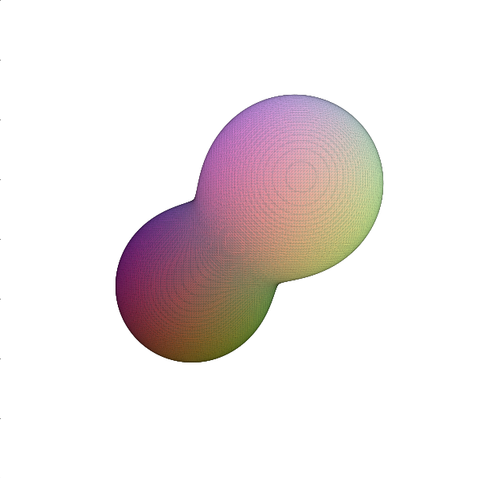

# torchmcubes: marching cubes for PyTorch

[](https://github.com/tatsy/torchmcubes/actions/workflows/build.yml)

> Marching cubes for PyTorch environment. Backend is implemented with C++ and CUDA.

## Install

### Requirements

- Python (3.9 or later)
- PyTorch
- C++20 compiler (GCC 10+, Clang 12+, or Visual Studio 2019 16.11+), required by recent PyTorch headers
- CUDA Toolkit 12 or later (optional, only for GPU support; nvcc needs CUDA 12 for C++20)
  - Without a CUDA toolkit a CPU-only build is produced. CUDA tensors are then processed on the CPU with a warning. ROCm/HIP is not supported.
- CMake (3.24 or later)

Make sure that you have nvcc CUDA compiler with the following command.

```shell
nvcc --version
```

If you have CUDA installed but not able to run nvcc, you might need to add it to your path:

```shell
export CUDA_HOME=/usr/local/cuda/
export PATH=$CUDA_HOME/bin:$PATH
```

### Pip installation

torchmcubes is compiled against the PyTorch installed in your environment. Install PyTorch first, then install the build dependencies and torchmcubes **without build isolation**.

```shell
# 1. Install PyTorch (if you need GPU support, choose the correct CUDA version)
pip install torch

# 2. Install build dependencies
pip install scikit-build-core pybind11

# 3. Build and install torchmcubes against the PyTorch installed above
pip install --no-build-isolation git+https://github.com/tatsy/torchmcubes.git
```

To build from a local checkout, run `pip install --no-build-isolation .` in the repository root instead of the last command.

### Development with uv

The development environment pins PyTorch to 2.6.0. On Windows and Linux, uv
installs the CUDA 12.4 build from the official PyTorch index; on macOS it uses
PyPI. These development settings do not pin the PyTorch version used by pip
users. Each built wheel records the minor series of the PyTorch used to build it.
GPU development also requires a compatible CUDA toolkit and C++ compiler.

An existing `.venv` can be reused. For a new checkout, create the environment first:

```shell
uv venv --python 3.9
```

Bootstrap only the locked development dependencies before installing the project.
`--frozen` reads the committed lockfile without resolving the project's dynamic
metadata. This makes the installed PyTorch and build tools available before
the project is built with isolation disabled:

```shell
uv sync --frozen --only-group dev --inexact
uv sync --locked --inexact
```

`--inexact` preserves packages already installed in a reused environment. Omit it
to make the installed packages match the selected lockfile dependencies exactly.
Commit `uv.lock` together with changes to the development dependencies.

For subsequent development, sync, build, and check the installed package with:

```shell
uv sync --locked --inexact
uv build
uv run --no-sync python -I -c "import torchmcubes; print(torchmcubes.__file__, torchmcubes.__version__, torchmcubes.HAS_CUDA)"
```

`uv sync` installs the project in editable mode. `uv build` creates an sdist and
a wheel in `dist/`; use `uv build --wheel` to build only a wheel. Building does
not install the resulting wheel or run tests. To check the wheel itself, install
its exact filename (which depends on the Python version and platform), then import it:

```shell
uv pip install --no-deps --reinstall-package torchmcubes dist/torchmcubes-0.1.0-cp39-cp39-win_amd64.whl
uv run --no-sync python -I -c "import torchmcubes; print(torchmcubes.__file__, torchmcubes.__version__, torchmcubes.HAS_CUDA)"
```

Use `uv sync --locked --inexact --reinstall-package torchmcubes` to restore the
editable installation afterward. When changing the development PyTorch version,
update the `dev` dependency and its index as needed, run `uv pip install --group dev`
to update the build environment, and then run `uv lock` and `uv sync`.

## Usage

See [mcubes.py](./mcubes.py) for more details (the example additionally needs `numpy` and `matplotlib`).

```python
import time
import numpy as np

import torch
from torchmcubes import marching_cubes, grid_interp

# Grid data
N = 128
xs = np.linspace(-1.0, 1.0, N, endpoint=True, dtype="float32")
ys = np.linspace(-1.0, 1.0, N, endpoint=True, dtype="float32")
zs = np.linspace(-1.0, 1.0, N, endpoint=True, dtype="float32")
zs, ys, xs = np.meshgrid(zs, ys, xs)

# Implicit function (metaball)
f0 = (xs - 0.35)**2 + (ys - 0.35)**2 + (zs - 0.35)**2
f1 = (xs + 0.35)**2 + (ys + 0.35)**2 + (zs + 0.35)**2
u = 4.0 / (f0 + 1.0e-6) + 4.0 / (f1 + 1.0e-6)

rgb = np.stack((xs, ys, zs), axis=-1) * 0.5 + 0.5
rgb = np.transpose(rgb, axes=(3, 2, 1, 0))
rgb = np.ascontiguousarray(rgb)

# Test
u = torch.from_numpy(u)
rgb = torch.from_numpy(rgb)
u = u.cuda()
rgb = rgb.cuda()

t_start = time.time()
verts, faces = marching_cubes(u, 15.0)
colors = grid_interp(rgb, verts)
t_end = time.time()
print(f"verts: {verts.size(0)}, faces: {faces.size(0)}, time: {t_end - t_start:.2f}s")

verts = verts.detach().cpu().numpy()
faces = faces.detach().cpu().numpy()
colors = colors.detach().cpu().numpy()
verts = (verts / (N - 1)) * 2.0 - 1.0  # Get back to the original space
visualize(verts, faces, colors)
```

## Screen shot



## Copyright

Mozilla Public License 2.0, 2019-2026 (c) Tatsuya Yatagawa
